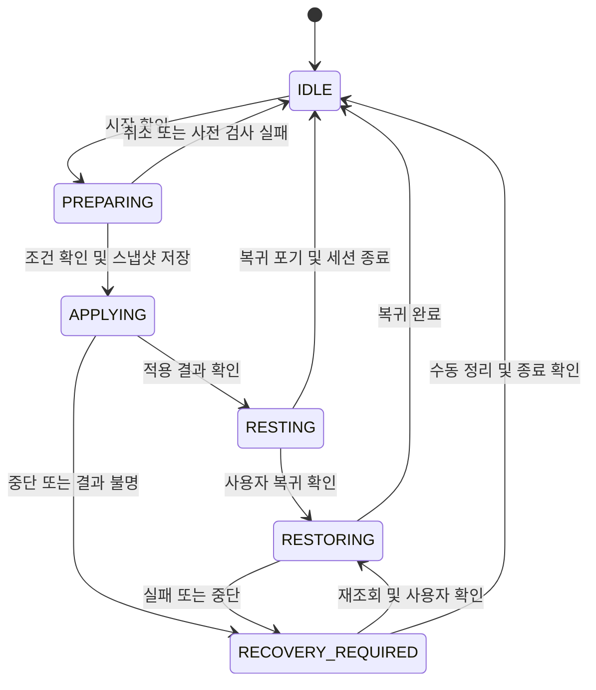
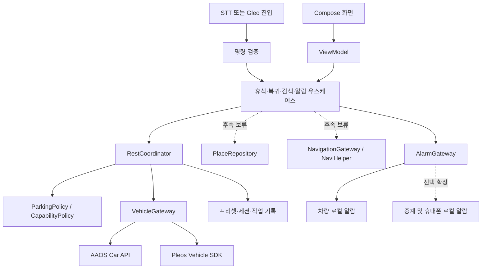

# 자비스 (자.peace) 상세 설계

문서 이관: 2026-11-08. 기존 루트 README의 상세 내용을 이 문서로 옮겼습니다. 사용자 요구·제안의 구분은 [CONTEXT](CONTEXT.md), 다음 작업은 [ROADMAP](ROADMAP.md), 검증 근거는 [VERIFICATION](VERIFICATION.md)을 확인합니다.

**내 차에서 쉬고 싶은 순간, 저장해 둔 나만의 휴식 환경을 준비하고 이전 설정으로 돌아오도록 돕는 Pleos Connect 앱.**

장거리 운전 중 졸음쉼터에 도착했을 때, 점심시간에 자차에서 잠깐 쉬고 싶을 때 사용합니다. 처음에 편한 자세와 환경을 저장해 두면, 이후에는 정차·주차 상태를 확인하고 사용자의 요청에 따라 적용합니다.

> **현재 상태: Android 초기 프로젝트 생성 — 2026-11-07**
>
> Kotlin·Compose 앱, 홈 화면, 차량 상태 인터페이스, 주차 조건 판정과 단위 테스트를 추가했습니다. `demo`는 모의 상태를 사용하며 `vehicle`은 공식 SDK 의존성을 포함하지만 실제 차량 연결·조작은 아직 구현하지 않았습니다. 프리셋·복귀·음성·알람 등 아래 상세 설계의 나머지 기능은 구현 예정입니다. [실행 방법](#12-실행-방법과-저장소-구성) · [개발 환경](DEVELOPMENT.md)

## 목차

1. [문제와 사용자](#1-문제와-사용자)
2. [제품 범위와 우선순위](#2-제품-범위와-우선순위)
3. [사용 시나리오와 화면](#3-사용-시나리오와-화면)
4. [차량 상태와 제어 규칙](#4-차량-상태와-제어-규칙)
5. [음성 호출과 장소 검색](#5-음성-호출과-장소-검색)
6. [알람과 휴대폰 연동](#6-알람과-휴대폰-연동)
7. [기술 구조](#7-기술-구조)
8. [데이터와 적용·복귀 절차](#8-데이터와-적용복귀-절차)
9. [오류 처리와 개인정보](#9-오류-처리와-개인정보)
10. [검증 계획과 완료 기준](#10-검증-계획과-완료-기준)
11. [개발 순서와 공모전 제출](#11-개발-순서와-공모전-제출)
12. [실행 방법과 저장소 구성](#12-실행-방법과-저장소-구성)
13. [참고 자료](#13-참고-자료)

## 1. 문제와 사용자

### 해결하려는 문제

차에서 쉬려면 좌석, 온도, 풍량, 조명 등을 매번 조정해야 합니다. 잠깐 쉬고 싶은 상황에서 이 과정은 번거롭고, 시동을 끄면 차량 앱의 알람이 계속 울릴지도 불확실합니다. 쉬고 난 뒤에는 원래 좌석과 환경으로 돌아오는 과정도 필요합니다.

첫 버전은 **주차 확인 → 개인 설정 적용 → 휴식·깨우기 → 이전 설정 복귀**에 집중합니다. ‘잘 자는 자세’를 앱이 임의로 계산하기보다, 사용자가 직접 맞춘 설정을 기억하는 것부터 시작합니다. 장소 탐색과 내비게이션 연동은 후속 단계로 미룹니다.

### 주요 사용자

| 사용자 | 이용 상황 | 우선 제공할 가치 |
| --- | --- | --- |
| 장거리 운전자 | 졸음쉼터·휴게소에서 짧게 휴식 | 졸음쉼터·휴게소에 주차한 뒤 빠른 휴식 준비 |
| 직장인 | 점심시간에 주차된 자차에서 혼자 휴식 | 반복 설정 최소화, 정해진 시간에 깨우기, 이전 설정 복귀 |
| 전기차 이용자 | 충전 대기 또는 주차 중 휴식 | 지원되는 공조·SOC 정보 활용 |
| 차박 이용자 | 장시간 정차·숙박 | 향후 별도 프리셋과 전원·배터리 안내로 확장 |

첫 타깃은 **짧은 휴식**입니다. 차박 전체를 지원하는 서비스는 후속 범위로 둡니다.

### 시장 조사와 근거의 해석

| 근거 | 확인한 내용 | 기획에 반영할 점 |
| --- | --- | --- |
| [한국도로공사 졸음쉼터 설치현황](https://www.data.go.kr/data/15043710/fileData.do), 2026-08-01 기준 | 한국도로공사 관리 대상 253개소 | 휴식 장소라는 실제 사용 접점이 있음. 전국 모든 도로의 총개소 수로 표현하지 않음 |
| [아주대 석사논문, 조현제, 2024](https://dcoll.ajou.ac.kr/dcollection/srch/srchDetail/000000033973) | 2021~2022년 9개 노선·138개 쉼터 분석. 연구 보고값은 일평균 이용 차량 470대, 이용률 2.01% | 쉼터 이용 자료로 활용. 2.01%는 교통량 대비 진입 차량 비율이며, 수면 이용률·주차 점유율이 아님 |
| [서울경제, 2025-06-18](https://v.daum.net/v/20250618105251898?s=print_news) | 점심시간에 혼자 쉬기 위해 차 등 개인 공간을 찾는 직장인 사례와 당시 차량 휴식 서비스 사례 소개 | 장거리 운전 외에 ‘직장인의 일상 휴식’도 사용 시나리오로 설정 |

253개소와 논문의 이용 차량 수를 곱해 전체 시장 규모로 추산하지 않습니다. 기사도 이용 사례를 보여 주는 정성 근거이며, 전체 직장인의 차량 수면 비율을 입증하지 않습니다. 기사에 등장한 서비스의 현재 운영 여부 역시 별도 확인이 필요합니다.

**추가 검증할 제품 가설:** 차에서 쉬는 사람이 실제로 반복 설정에 불편을 느끼는지, 가장 자주 조정하는 항목이 무엇인지, 휴대폰 알람만으로 충분한지를 인터뷰와 프로토타입으로 확인합니다. 설정 완료 시간, 실패·복귀 성공률, 재사용 의향을 측정하고 사업성은 그 결과에 따라 판단합니다. 유료 전환율이나 시장 점유율은 아직 추정하지 않습니다.

### 차량 앱으로서의 차별점

핵심은 일반 타이머를 차량 화면에 옮기는 것이 아니라, **실제 차량 상태에 따라 실행 가능 여부를 판단하고, 지원되는 차량 기능을 개인 프리셋으로 적용·복귀하는 것**입니다. 음성은 이 흐름의 진입 수단으로 사용합니다. 생성형 AI는 MVP의 필수 구성 요소로 두지 않습니다.

## 2. 제품 범위와 우선순위

| 단계 | 기능 | 완료 기준 |
| --- | --- | --- |
| P0 · 핵심 MVP | 주차 상태 판단, 기능 지원 여부 조회 | P·속도·권한·연결 상태에 따라 버튼과 실행을 동일하게 제한 |
| P0 · 핵심 MVP | 현재 설정으로 휴식 프리셋 저장 | 사용자가 선택한 좌석·지원 항목을 읽어 로컬 저장 |
| P0 · 핵심 MVP | 프리셋 적용, 진행 상태, 이전 설정 복귀 | 변경 전 스냅샷 저장, 항목별 결과 확인, 실패·중단 후 복구 가능 |
| P1 · 경험 확장 | 앱 내 STT/TTS | 음성·터치가 동일한 도메인 로직을 거쳐 휴식·알람·복귀 요청 처리 |
| P1 · 경험 확장 | 차량 내 알람, 휴식 화면 | 전원 유지 조건에서 실제 발화·소리 확인, 전원 종료 한계 표시 |
| P2 · 별도 검증 | Gleo 앱 호출, Android 휴대폰 알람 연동 | 실제 호출 및 휴대폰 예약 확인 응답까지 검증 |
| P3 · 후속 보류 | B 시나리오: 휴식 장소·숙소 검색, 기존 내비게이션 연동 | 핵심 휴식 흐름 완성 후 별도 착수. 첫 버전·1차 제출 개발 범위에서 제외 |
| P3 · 탐색 | 개인 호출어, 커스텀 음성, 차박, 외부 음악 앱 | 권한·수명주기·오디오 정책·연동 API 검증 후 채택 |

**첫 데모의 필수 흐름:** 프리셋 저장 → 주행 상태에서 적용 차단 → P·정지 확인 → 적용 → 변경 결과 표시 → 사용자 요청으로 복귀.

좌석 자동 이동은 목표이지만, 해당 차량·SDK에서 위치 조회·설정·진행 확인·중단 동작을 먼저 검증합니다. 조건을 충족하지 못하면 해당 좌석은 수동 조작 안내로 제공하고, 지원되는 공조·조명만 적용합니다. 이 경우 데모에서도 자동 이동 지원 여부를 명확히 표시합니다.

초기 버전은 시동·기어·브레이크·조향을 제어하지 않습니다. 도어·창문 자동 개폐와 주행 중 동승석 휴식 자세 적용도 초기 범위에서 제외합니다. 알람 종료나 기어 변경을 계기로 좌석을 자동 이동시키지 않습니다.

## 3. 사용 시나리오와 화면

### A. 처음 한 번: 내 휴식 환경 저장

1. 사용자가 안전한 장소에 주차하고 앱을 엽니다.
2. 앱이 P·정지 상태와 지원 기능을 확인합니다.
3. 사용자가 차량의 기본 조작부로 좌석과 환경을 직접 맞춥니다.
4. 대상 좌석을 고르고 저장할 항목만 선택합니다.
5. 앱이 현재 값을 읽어 ‘점심 휴식’, ‘졸음쉼터’ 등의 이름으로 저장합니다.
6. 지원하지 않거나 값을 읽을 수 없는 항목은 저장 대상에서 제외하고 이유를 표시합니다.

앱의 ‘현재 설정 저장’ 버튼이 차량을 움직이게 하지는 않습니다. 프리셋을 다른 차량에서 사용할 때는 지원 범위와 값을 다시 확인하고 재등록합니다.

### B. 이동 중: 쉴 곳 찾기 — 후속 단계로 보류

이 시나리오는 현재 구현 범위에서 제외합니다. 내비게이션 엔진·지도·길 안내를 직접 개발하지 않고, 향후 장소 검색 결과의 목적지를 NaviHelper로 기존 Pleos Connect Navigation 앱에 전달하는 방향입니다. 특정 타사 내비 앱을 자유롭게 선택·제어할 수 있는지는 별도 확인 대상입니다. [NaviHelper 소개](https://document.pleos.ai/en/docs/pleos-only/connect-sdk-pleos/NaviHelper/intro)

1. “근처 졸음쉼터 찾아줘” 또는 “근처 숙소 찾아줘”라고 요청합니다.
2. 앱은 이동 방향·접근 가능성을 확인할 수 있는 후보를 우선 제시합니다.
3. 사용자가 목적지를 선택하고 기존 경로 변경을 확인합니다.
4. 내비게이션에 전달한 뒤 실제 경로 설정 결과를 확인합니다.
5. 도착만으로 휴식 설정을 적용하지 않습니다. P·정지와 사용자 요청이 필요합니다.

### C. 주차 후: 바로 쉬기

1. 프리셋과 휴식 시간을 고릅니다.
2. 대상 좌석, 이동할 항목, 좌석 주변·뒷좌석 공간을 사용자가 확인합니다.
3. 앱은 현재 차량 값을 스냅샷으로 저장한 뒤 적용을 시작합니다.
4. ‘좌석 완료 / 온도 완료 / 조명 미지원’처럼 실제 결과를 표시합니다.
5. 휴대폰 알람을 선택했다면 예약 확인 결과를 보여 줍니다.
6. 휴식 화면으로 전환합니다. 시동 종료는 사용자가 차량에서 직접 수행합니다.

### D. 휴식 종료: 깨우기와 복귀

1. 알람을 울리고 사용자가 끄거나 다시 울림을 선택합니다.
2. ‘이전 설정으로 돌아가기’를 별도로 선택합니다.
3. P·정지, 현재 값, 복귀 가능 항목을 다시 확인합니다.
4. 사용자가 확인하면 복귀하고 항목별 결과를 표시합니다.
5. 완료 또는 사용자의 복귀 포기로 세션을 닫습니다.

복귀 중 실패하면 복구 정보를 유지합니다. 앱을 다시 켜도 좌석 이동을 자동 재실행하지 않고, 상태를 재조회한 뒤 선택지를 보여 줍니다.

### 화면 구성

| 화면 | 주요 내용 | 제약·처리 |
| --- | --- | --- |
| 홈 | 주차 상태, 프리셋, 휴식 시작 | 실행 불가 이유를 구체적으로 표시 |
| 프리셋 관리 | 이름, 대상 좌석, 선택 항목, 현재 값 저장 | 주차 중 편집, 미지원 항목 구분 |
| 시작 확인 | 변경 항목, 공간 확인, 알람 전달 상태 | 확인 후 한 번만 실행, 중복 입력 방지 |
| 적용·복귀 진행 | 항목별 대기·실행·완료·실패, 중단 | 중단 명령의 차량 지원 여부도 표시 |
| 휴식 | 어두운 앱 화면, 남은 시간, 알람, 복귀 | 차량 전체 화면·전원을 강제 제어하지 않음 |
| 장소 검색 · 후속 보류 | 졸음쉼터·휴게소·숙소 후보, 출처·갱신 시점 | 첫 버전에는 화면·검색·길 안내 연동을 만들지 않음 |
| 알람·휴대폰 | 예약 시각, 울릴 기기, 예약 확인 상태 | ‘전달 중’과 ‘예약 완료’를 구분 |
| 복구 안내 | 미확인 변경, 복귀 가능한 항목, 수동 안내 | 자동 재적용 없이 사용자 선택 |
| 설정 | 권한, 데이터 삭제, 음성·연동 설정 | 선택 기능 거절 시 핵심 기능 유지 |

주행 중 UI는 플랫폼의 운전 중 사용 제한에 따릅니다. 장소 탐색의 음성 흐름도 플랫폼이 허용하는 범위에서만 제공하며, 제한되는 경우 정차 후 사용하도록 안내합니다. 운전자용 화면에 동승자라는 이유로 주행 제한을 우회하는 모드를 만들지 않습니다.

## 4. 차량 상태와 제어 규칙

### 차량 조작 API 확인 수준

**차량 조회뿐 아니라 제어 API도 공식 SDK에 존재합니다.** 다음은 2026-11-07 공식 API 목록에서 확인한 실제 함수명입니다. 앱 내부 인터페이스명과 구분합니다.

| 항목 | 공식 문서에서 확인한 API 예 | 현재 확인 수준 |
| --- | --- | --- |
| 좌석 등받이·앞뒤 이동 | `moveSeatBackrestAngle`, `moveSeatForeAft` | [Seat API 목록](https://document.pleos.ai/en/docs/pleos-only/connect-sdk-pleos/Vehicle/vehicle/ai.pleos.playground.vehicle.api/seat/entry)에서 제어·위치 조회·지원 여부 확인 함수 존재 확인 |
| 좌석 메모리·열선·통풍 | `selectSeatMemory`, `setHvacSeatTemperature`, `setHvacSeatVentilation` | 같은 Seat API 목록에서 함수 존재 확인. 메모리 선택이 앱의 임의 위치 저장을 뜻하지는 않음 |
| 공조 온도·풍량 | `setHvacTemperature`, `setHvacFanSpeed` | [HVAC API 목록](https://document.pleos.ai/en/docs/pleos-only/connect-sdk-pleos/Vehicle/vehicle/ai.pleos.playground.vehicle.api/h-v-a-c/entry)에서 제어 함수 존재 확인 |
| 앰비언트 조명 | `setAmbientLightBrightness`, `setAmbientLightBrightnessColor` | [Light API 목록](https://document.pleos.ai/en/docs/pleos-only/connect-sdk-pleos/Vehicle/vehicle/ai.pleos.playground.vehicle.api/light/entry)에서 제어 함수 존재 확인 |

제어 API의 존재는 확인했지만, **저장한 임의 좌석 위치를 정확히 재현하는 방법·위치 단위·이동 완료·중단 의미와 해당 에뮬레이터의 실제 지원 여부는 아직 확인하지 않았습니다.** API 이름만으로 절대 위치를 지정할 수 있다고 가정하지 않습니다. 첫 개발 작업에서 실제 SDK 시그니처와 지원 범위를 확인하고, 현재 위치 조회 → 이동 → 정지 → 재조회가 되는지 검증한 뒤 프리셋 적용 방식을 확정합니다.

읽기 권한과 제어 권한은 별도입니다. 공식 권한 문서는 `CAR_*`와 `CONTROL_CAR_*`를 구분하며, 호출별 `@RequiresPermission` 확인을 요구합니다. 권한과 차종·좌석별 capability를 함께 확인합니다. [권한 문서](https://document.pleos.ai/en/docs/pleos-only/connect-sdk-pleos/Vehicle/vehicle-permission)

### 실행 조건

차량 설정 적용·복귀는 아래 조건을 **모두** 만족할 때만 시작합니다.

- 차량 서비스 연결 및 해당 읽기·쓰기 권한이 유효함.
- 기어가 P이고, 정상 상태의 속도 데이터로 정지임을 확인함.
- 선택한 기능이 해당 좌석·영역에서 지원되고 목표 값이 허용 범위 안에 있음.
- 현재 값 조회에 성공해 변경 전 상태를 저장할 수 있음.
- 사용자가 대상 좌석과 공간을 확인했으며 다른 작업이 진행 중이지 않음.

속도·기어 중 하나라도 알 수 없거나 오류 상태이면 허용하지 않습니다. 표준 API 속도는 m/s이므로 단위를 명시적으로 처리합니다. 정지 판정 허용 오차와 안정화 시간은 실제 SDK 데이터 특성을 확인한 후 정하며, 느리게 움직이는 상태를 주차로 간주하지 않습니다.

상태의 신뢰성은 값·상태 코드·타임스탬프·연결 세대를 함께 검사합니다. ON_CHANGE 속성은 값이 안 변하면 콜백이 없을 수 있으므로, 단순히 마지막 변화가 오래됐다는 이유만으로 오류 판정하지 않습니다. 실행 전 재조회와 구독 상태 확인을 조합하고, 데이터 유효성을 확인할 수 없으면 실행을 보류합니다.

### 실행 중 상태 변화

- 각 제어 요청 직전에 실행 조건을 다시 확인합니다.
- 기어·속도 변경, 연결 해제, 권한 상실이 발생하면 후속 요청을 중단합니다.
- **코루틴 취소가 실제 좌석의 물리적 이동 중단을 뜻하지는 않습니다.** 차량의 중단 API와 동작을 별도로 검증합니다.
- 좌석 자동 이동은 상태 변화·사용자 중단 시 실제 이동을 중단할 수 있는지 검증한 환경에서만 활성화합니다. 미검증 환경에서는 수동 조작을 안내합니다.
- 중단·타임아웃 직후 반대 방향 명령이나 자동 복귀를 보내지 않습니다. 실제 현재 상태를 확인한 뒤 사용자에게 다음 행동을 제시합니다.
- 알람·위치 도착·음성 인식 결과만으로 확인 절차를 생략하지 않습니다.

P 상태와 소프트웨어 점검만으로 주변 공간이나 신체 끼임을 판단할 수는 없습니다. 좌석 이동 순서·범위·중단 방식은 제조사 기능과 제약을 따르고, 가상의 공통 이동 순서를 하드코딩하지 않습니다.

### 세션 상태



일부 항목이 명확히 실패한 경우, 실제 적용된 항목을 표시하고 사용자가 수락하면 RESTING으로 진행할 수 있습니다. 결과가 불명확하면 RECOVERY_REQUIRED로 이동합니다. 프로세스가 적용·복귀 도중 종료되었거나 재시작 시 저장 상태와 차량 값이 다르면 자동 재실행 없이 복구 단계로 진입합니다. 알람 상태는 이 세션 상태와 별도로 관리합니다.

## 5. 음성 호출과 장소 검색

### 음성 입력은 세 경로로 나누어 검증

| 경로 | 공식 문서에서 확인한 범위 | 자.peace의 결정 |
| --- | --- | --- |
| 앱 내 음성 버튼 | Pleos STT의 `request()`로 인식 시작, `stop()`으로 종료 | 첫 음성 구현. 유한한 인식 세션으로 사용 |
| Gleo를 통한 앱 호출 | 앱 스키마와 Intent 기반 기능 연동, 스키마 검토·승인 절차 존재 | 시스템 음성 진입 경로의 우선 검증 대상 |
| 앱 자체 ‘자비스’ 상시 호출어 | STT 지원만으로 상시 대기·부팅 자동 실행 권한까지 확인되지는 않음 | 별도 실험 기능. MVP의 전제에서 제외 |

공식 근거: [STT 시작·종료](https://document.pleos.ai/en/docs/pleos-only/connect-sdk-pleos/SpeechToText/start-and-stop), [Gleo 예제](https://document.pleos.ai/docs/pleos-only/app-integration-guide/guide/examples), [Gleo 스키마 전달](https://document.pleos.ai/docs/pleos-only/app-integration-guide/guide/deliver-schema).

**판단:** 차량에 음성 비서가 있다는 사실과 일반 앱이 계속 마이크를 점유할 수 있다는 사실은 다릅니다. 현재 문서만으로 앱 자체의 무제한 상시 대기를 보장할 수 없습니다. Gleo의 승인·등록·에뮬레이터 사용 가능 여부도 실제로 확인해야 합니다.

직접 마이크를 사용하는 개인 호출어 실험은 Android의 microphone foreground service, 런타임 권한, 백그라운드 시작 제한과 차량 오디오 정책을 따릅니다. 사용자가 앱을 연 상태에서 시작한 세션을 유지할 수 있는지와 재부팅·전원 전환 후 동작은 별개입니다. STT 서비스 경유 권한과 직접 녹음 권한도 구분합니다. [Android foreground service 문서](https://developer.android.com/develop/background-work/services/fgs/service-types#microphone)

커스텀 음성 녹음은 그 자체로 안정적인 호출어 인식기가 되지 않습니다. 후속 단계에서 로컬 호출어 모델, 오인식·미인식, 다른 음성 비서와의 마이크 경쟁, 리소스 사용량을 검증하고 녹음 데이터 보관·삭제 정책을 정합니다.

### 명령 처리

| 발화 예시 | 해석 | 실행 |
| --- | --- | --- |
| “점심 휴식 준비해 줘” | 프리셋 선택 요청 | 조건 확인 및 시작 확인 화면 |
| “20분 뒤 깨워 줘” | 알람 예약 요청 | 예약 기기·시각 확인 후 예약 |
| “근처 졸음쉼터 찾아줘” | 장소 검색 요청 | 후보 검색·선택 |
| “근처 숙소 찾아줘” | 숙소 검색 요청 | 후보 제공, 예약·결제는 하지 않음 |
| “원래대로 해 줘” | 활성 세션 복귀 요청 | 복귀 미리보기 및 사용자 확인 |
| “멈춰” | 현재 작업 중단 요청 | 후속 요청 중단, 지원되는 물리 중단 호출 |

초기에는 제한된 명령과 슬롯(프리셋, 시간, 장소 종류)을 사용합니다. 인식이 모호하면 다시 확인하고, 음성·터치·Gleo가 같은 유스케이스를 호출하게 합니다. Gleo 연동용 함수명은 앱 구현 시 정의하며 이 문서의 발화가 공식 내장 명령이라는 의미는 아닙니다.

Gleo의 `assets/schema.json` 및 Manifest 연동은 별도 구현 대상입니다. 외부 Intent는 명령·파라미터를 허용 목록으로 검사하고, 들어온 값으로 차량 API를 직접 호출하지 않습니다. 지원되는 발신자 검증 수단을 확인하고 모든 제어는 상태 검사와 사용자 확인을 거칩니다.

### 장소 검색과 길 안내를 분리 — 후속 설계 참고

이 절은 B 시나리오를 재개할 때 사용할 설계입니다. 현재는 장소 API 계약·지도 화면·내비게이션 연동을 구현하지 않습니다. 우리가 담당할 부분은 장소 후보 검색·선택·목적지 전달이며, 경로 계산·지도 렌더링·길 안내는 기존 내비게이션이 담당합니다.

1. `PlaceRepository`가 공공 데이터·장소 검색 API에서 후보를 가져옵니다.
2. 노선, 진행 방향, 진입 가능성, 거리·예상 시간 등 확인 가능한 정보로 정렬합니다.
3. 사용자가 선택하고 기존 경로 변경을 확인합니다.
4. `NavigationGateway`가 NaviHelper로 목적지를 전달합니다.
5. 요청 수락과 경로 탐색 완료를 구분해 최종 결과를 표시합니다.

[NaviHelper 문서](https://document.pleos.ai/en/docs/pleos-only/connect-sdk-pleos/NaviHelper/destinations)는 좌표 기반 목적지 전달과 이벤트 콜백을 설명합니다. 이를 숙소 검색 API나 전국 졸음쉼터 검색 API로 간주하지 않습니다.

공공 졸음쉼터 자료의 명칭·노선·이정·방향과 지도상의 좌표를 매칭하는 과정이 필요합니다. 좌표와 반대편 차로 접근성을 검증하지 않은 후보를 ‘가장 가까운 이용 가능 쉼터’로 단정하지 않습니다. 경로상 접근성 계산을 제공하는 API가 확보되지 않으면 검증된 제한 지역부터 시작하고, 남은 후보는 접근 가능성 확인이 필요하다고 표시합니다. 숙소 검색 제공자, 이용 약관, 요금, API 키 관리 방식은 연동 전에 확정합니다.

초기 데모의 고정 후보는 반드시 ‘시연용 데이터’로 표시합니다. 실제 검색과 더미 응답을 혼용하지 않습니다. 주행 중 자동으로 목적지를 변경하지 않습니다.

## 6. 알람과 휴대폰 연동

### 차량 전원에 따른 동작

| 상황 | 설계 |
| --- | --- |
| 차량 앱과 오디오가 정상 동작 중 | 차량 로컬 알람 제공, 실제 출력과 오디오 포커스 검증 |
| 차량 전원 종료·절전·프로세스 종료 | 차량 알람 지속을 보장하지 않음. 휴대폰 예약 여부 안내 |
| 휴대폰 알람 예약 확인 완료 | 차량과 연결이 끊겨도 휴대폰 자체의 로컬 예약으로 울리도록 구현 |
| 휴대폰 미연결·권한 거절·전송 실패 | 휴대폰 예약 실패·미확인 표시, 사용자가 휴대폰에서 직접 예약하도록 안내 |

AAOS는 차량 전원에 따라 suspend·hibernation·shutdown 상태로 전환될 수 있습니다. 앱이 임의로 시동을 끄거나 차량을 계속 켜 두는 구조를 전제하지 않습니다. [AAOS 전원 관리](https://source.android.com/docs/automotive/power)

### 차량 알람

알람 시각을 영속 저장하고, 지원되는 Android 알람 API로 예약합니다. 단순 화면 카운트다운이나 코루틴 `delay`만으로 구현하지 않습니다. 정확한 알람 권한·오디오 출력·화면 꺼짐 상태를 확인하고, 사용할 수 없으면 제한을 표시합니다. 차량 내 알람은 전원 종료에 대한 대체 수단이 아닙니다. [Android 알람 가이드](https://developer.android.com/develop/background-work/services/alarms/schedule)

### Android 휴대폰 연동안 — P2

차량과 휴대폰을 연결하는 SDK가 제공된다고 가정하지 않습니다. 첫 실험은 **Android companion 앱 + 인증된 HTTPS 중계**로 설계하고, BLE·iOS는 후속 검토로 둡니다. 중계 서버나 휴대폰 앱은 아직 구현하지 않았습니다.

1. 주차 중 일회용·만료형 연결 코드로 두 기기를 페어링하고 휴대폰에서 승인합니다.
2. 차량은 `alarmId`, `revision`, `wakeAtUtc`, 표시용 시간대, 작업 종류(예약·변경·취소)를 전송합니다.
3. 휴대폰은 요청을 검증하고 권한 확인·로컬 저장·OS 알람 예약을 수행합니다.
4. 모든 단계가 성공한 뒤 동일 ID·revision의 예약 확인 응답을 보냅니다.
5. 차량은 이 응답을 받은 경우에만 ‘휴대폰 예약 완료’로 표시합니다.

서버 수신이나 푸시 전달 성공은 휴대폰 예약 성공이 아닙니다. 푸시를 사용하더라도 동기화 계기일 뿐, 정해진 시각에 푸시가 도착하는 것을 알람으로 삼지 않습니다. 중복 요청은 ID·revision으로 처리하고, 변경·취소도 휴대폰 확인 전에는 완료로 표시하지 않습니다. 응답이 없으면 마지막으로 확인된 예약과 새 요청의 미확인 상태를 함께 보여 줍니다.

휴대폰은 프로세스 재시작·재부팅·권한 변경·시간 변경을 처리하고 OS 정책을 재확인합니다. 휴대폰 전원이 꺼졌거나 앱이 강제 중지된 상태까지 울림을 보장하지 않습니다. 예약 확인 응답은 예약 당시의 성공을 뜻하며 이후 권한 취소까지 보장하지 않습니다.

휴식 알람과 차량 좌석 복귀는 별개입니다. 알람이 울리거나 휴대폰에서 알람을 꺼도 차량 설정은 자동 변경하지 않습니다.

### 음악·전기차·차박 확장

초기 사운드는 사용 권한을 확보한 앱 내 음원으로 한정하고 통화·내비게이션 음성과 오디오 포커스를 조정합니다. Spotify 등 다른 앱의 자동 재생은 공식 연동 가능 여부를 확인한 뒤 추가합니다.

전기차는 SOC·충전 상태를 표시하고 지원 기능을 활용할 수 있지만, 배터리 정보 조회를 유틸리티 모드·장시간 공조 제어 권한으로 해석하지 않습니다. 장시간 전원 유지, 차박용 공조, 저전력 알림은 차종·API 검증 후 별도 기능으로 설계합니다.

## 7. 기술 구조

### 선택한 구현 방향

| 영역 | 설계 선택 |
| --- | --- |
| 차량 앱 | Kotlin, Android Studio, AAOS/Pleos Connect |
| UI | Jetpack Compose를 1차 후보로 사용. Pleos UI·주행 제한 정책과 샘플 호환성 확인 후 확정 |
| 비동기·상태 | Coroutines, Flow/StateFlow, ViewModel |
| 차량 상태 | 표준 AAOS Car API 우선, 제조사 특화 제어는 Pleos Vehicle SDK |
| 로컬 저장 | Room: 프리셋·세션·변경 기록·알람, DataStore: 가벼운 사용자 설정 |
| 의존성 구성 | 초기 단일 앱 모듈에서 생성자 주입. 필요해지면 별도 DI 도입 |
| 테스트 | 도메인 단위 테스트, Fake adapter의 장애 주입, Pleos Emulator·Virtual Console 통합 검증 |
| 서버 | 차량 핵심 MVP에는 불필요. 휴대폰 연동 또는 장소 제공자 요구 시 별도 추가 |

속도·기어 등 표준 정보는 AAOS, 좌석 등 특화 기능은 Pleos SDK를 우선 검토합니다. 실제 권한·속성·대상 영역은 각 참조 문서와 목표 이미지에서 확인합니다. [Pleos API 정책](https://document.pleos.ai/en/docs/pleos-only/vehicle-app-planning-guide/pleos-connect-sdk-api), [AAOS VehiclePropertyIds](https://developer.android.com/reference/android/car/VehiclePropertyIds)

공식 Vehicle 소개 문서의 기준 버전은 SDK v2.3.2 / Vehicle Service v2.3.21입니다. 프로젝트는 Gradle 8.12·AGP 8.9.2·Kotlin 2.2.21·minSdk 28·targetSdk 34·compileSdk 35로 시작하며, 차량 빌드에 Vehicle SDK 2.3.2를 선언했습니다. 실제 Pleos 이미지·서비스와의 실행 호환성은 별도 검증합니다. [Vehicle SDK 소개](https://document.pleos.ai/en/docs/pleos-only/connect-sdk-pleos/Vehicle/intro)

### 구성도

장소 검색·NaviHelper 경로는 후속 확장 구조입니다. 초기 구현에서는 해당 adapter와 화면을 생성하지 않습니다.



아래 이름은 **앱 내부 설계 인터페이스**이며 Pleos가 제공하는 클래스명이 아닙니다.

| 구성 요소 | 책임 |
| --- | --- |
| `VehicleGateway` | 연결·현재 상태·지원 범위 조회, 정규화된 제어 요청, 결과·상태 변화 전달 |
| `ParkingPolicy` | P·정지·데이터 유효성에 따른 허용/차단 사유 반환 |
| `CapabilityPolicy` | 좌석·영역별 지원 범위, 값·단위·범위 검증 |
| `RestCoordinator` | 단일 세션, 적용·중단·복귀 순서와 상태 전이 관리 |
| `PresetRepository` | 프리셋 저장·수정·차량 적합성 확인 |
| `SessionRepository` | 변경 전 스냅샷과 항목별 작업 기록의 트랜잭션 저장 |
| `VoiceGateway` | 인식 세션과 결과 전달. 직접 차량을 제어하지 않음 |
| `PlaceRepository` | 후보 검색·출처·갱신 시점·접근성 정보 제공 |
| `NavigationGateway` | 목적지 요청과 경로 완료·오류 구분 |
| `AlarmGateway` | 기기별 예약·변경·취소와 확인 상태 관리 |

SDK 콜백은 adapter 안에서 도메인 결과로 변환하고 UI가 SDK를 직접 호출하지 않게 합니다. Fake 구현과 실제 adapter는 명확히 구분합니다. SDK 연결 해제와 리스너 해제는 수명주기에 맞추되, 미완료 요청을 성공으로 처리하지 않습니다.

## 8. 데이터와 적용·복귀 절차

### 주요 데이터

| 모델 | 주요 필드·의미 |
| --- | --- |
| `RestPreset` | ID, 이름, 대상 좌석, 선택한 설정, 스키마 버전, 차량 적합성 정보 |
| `SettingValue` | 설정 키, 영역 ID, 값, 단위, SDK 매핑 버전 |
| `VehicleContext` | 연결 세대, 속도·기어·각 데이터의 정상 여부와 시각, 지원 기능 |
| `RestSession` | 세션 ID, 프리셋 버전, 상태, 시작 시각, 적용·복귀 결과 |
| `BeforeSnapshot` | 변경 대상의 원래 값과 관측 정보. 실제 제어 전에 영속 저장 |
| `SettingOperation` | 작업 ID, 세션 ID, 순서, 이전 값, 목표 값, 확인된 적용 값, 상태, 오류 |
| `AlarmRecord` | 알람 ID·revision, UTC 시각·시간대, 대상 기기, 예약·취소 확인 상태 |

좌석 위치·각도를 모든 차에서 동일한 백분율로 가정하지 않습니다. SDK의 원래 단위와 영역을 보존하고 adapter에서 검증합니다. 지원 범위 밖의 값을 임의 보정해 적용하지 않고 사용자에게 알립니다.

VIN은 핵심 기능에 필요하지 않으므로 수집하지 않습니다. 로컬 차량 프로필과 지원 기능 정보를 사용하며, 동일 차량임을 확인할 수 없는 경우 저장한 좌석 값을 자동 적용하지 않고 재확인·재등록하도록 합니다.

### 프리셋 적용

1. 실행을 직렬화하고 동일 요청의 중복 실행을 방지합니다. 활성 세션이 있으면 새 스냅샷으로 덮어쓰지 않습니다.
2. 현재 차량 조건, 대상 영역, 기능·값 범위와 읽기·쓰기 권한을 확인합니다.
3. 변경 대상의 원래 값을 조회하고 **스냅샷과 실행 계획을 DB 트랜잭션으로 저장**합니다. 저장 실패 시 차량에 쓰지 않습니다.
4. 항목별 실행 직전에 조건을 재확인하고 작업을 `DISPATCHED`로 영속 기록한 후 요청합니다.
5. SDK 결과와 실제 현재 값·이동 상태를 조회해 완료 여부를 판단합니다.
6. 항목별 결과를 `CONFIRMED / FAILED / UNKNOWN`으로 기록하고 사용자에게 보여 줍니다.

기본 작업 흐름은 `PLANNED → DISPATCHED → CONFIRMED / FAILED / UNKNOWN`입니다. DB와 차량 제어를 하나의 원자적 트랜잭션으로 묶을 수는 없습니다. 요청 직전·직후 앱이 종료되면 실행 여부가 불명확할 수 있으므로, 재시작 시 현재 값을 재조회해 조정합니다.

연결 세대·세션·작업 ID와 결과를 연결하고 이전 요청의 늦은 콜백이 새 작업을 완료 처리하지 못하게 합니다. SDK가 요청 ID를 제공하지 않으면 같은 설정의 요청을 직렬화하고 재조회로 확인합니다. 타임아웃 후 곧바로 같은 이동 명령을 재전송하지 않습니다. 시간 제한과 비교 허용 오차는 기능별 SDK 특성·실측으로 정합니다.

여러 기능이 한 번에 모두 적용된다고 가정하지 않습니다. 좌석의 여러 축을 움직이는 순서와 동시 제어 가능 여부를 검증하고, 확인한 순서로만 실행합니다. 실행 중 사용자의 수동 조작 등 외부 변경이 감지되면 해당 항목을 재평가하고 충돌을 표시합니다.

### 이전 설정으로 복귀

1. P·정지, 지원 기능과 현재 값을 다시 확인합니다.
2. 앱이 변경한 항목과 적용 결과가 미확인인 항목을 작업 기록에서 구분합니다.
3. 현재 값이 마지막으로 확인된 앱 적용 값과 일치하면 원래 값으로 복귀할 후보가 됩니다.
4. 값이 달라졌다면 사용자의 수동 조작 등 다른 변경일 수 있으므로 ‘현재 유지 / 이전 값으로 복귀’를 선택하게 합니다.
5. 결과가 미확인인 항목은 재조회·사용자 확인 전 자동 복귀하지 않습니다.
6. 실제 복귀 결과를 확인하고 완료된 항목만 종료 처리합니다.

실패 시 전체를 무조건 되돌리는 자동 롤백은 사용하지 않습니다. 원래 값의 스냅샷은 복귀·사용자의 명시적 종료 전까지 유지합니다. 일부 항목이 실패하면 남은 항목과 수동 복귀 방법을 보여 줍니다. 동일한 값으로 돌아왔다는 사실만으로 사용자가 운전할 준비가 되었다고 판정하지 않습니다.

### 저장 수명

프리셋은 사용자가 삭제할 때까지 로컬에 유지합니다. 활성 세션과 복구 기록은 해결될 때까지 보존하고, 종료된 세션의 상세 값은 정리합니다. 백업·복원으로 다른 차량에 설정이 옮겨져도 자동 적용하지 않도록 차량 설정 데이터는 기본 클라우드 백업에서 제외하는 방향으로 구현합니다.

## 9. 오류 처리와 개인정보

### 오류별 동작

| 상황 | 처리 |
| --- | --- |
| 기어·속도 값 없음, 비정상 상태 | 적용·복귀 차단, 재조회·연결 안내 |
| 미지원 기능·영역 | 항목 제외 및 이유 표시, 지원 기능만 선택 가능 |
| 권한 거절 | 해당 기능 비활성화. 꼭 필요한 시점에 재안내 |
| 스냅샷 저장 실패 | 차량 쓰기 요청을 시작하지 않음 |
| 일부 제어 실패 | 성공·실패·불명 항목 분리, 부분 적용 수락 또는 복구 안내 |
| 좌석 이동 중 조건 변화 | 후속 명령 차단, 검증된 중단 동작, 현재 상태 확인 |
| 타임아웃·늦은 콜백 | 성공으로 추정하지 않음, 세션·연결 세대 검사와 재조회 |
| 차량 서비스·프로세스 종료 | 기록 유지, 다음 실행에서 복구 안내 |
| 네트워크·장소 API 실패 | 수동 장소 선택 또는 검증된 캐시 제공, 갱신 시점 표시 |
| 휴대폰 응답 없음 | 예약 미확인 표시, 마지막 확인 예약 유지 여부 안내 |
| 알람 권한 상실 | 예약 상태 재평가, 사용자에게 다른 예약 수단 안내 |

### 권한과 데이터 원칙

차량 SDK는 필요한 도메인·읽기·쓰기 권한만 선언하고 런타임 지원 여부를 확인합니다. 개발 단계에서 권한 선언으로 사용할 수 있다는 안내를 모든 차종·배포 환경에서의 권한 보장으로 해석하지 않습니다. [Vehicle 권한 문서](https://document.pleos.ai/en/docs/pleos-only/connect-sdk-pleos/Vehicle/vehicle-permission)

- 위치는 사용자가 장소를 검색할 때 요청하고 이동 이력을 기본 저장하지 않습니다.
- 음성 원본은 기본 저장하지 않습니다. 서버 인식 모드 사용 시 외부 처리 조건을 안내합니다.
- 차량 제어에 필요하지 않은 VIN·연락처·카메라 데이터는 수집하지 않습니다.
- 휴대폰 중계에는 알람·페어링에 필요한 최소 정보만 보내고 좌석 값·위치·VIN은 보내지 않습니다.
- 연동 토큰은 안전한 저장소에 보관하고 페어링 해제 시 폐기합니다.
- API 키·서명 키·개인별 설정 파일을 Git에 올리지 않습니다. APK에 넣은 비밀 키를 안전한 서버 비밀로 간주하지 않습니다.
- 로그는 작업 ID·기능 키·오류 코드 중심으로 기록하고 원음·정밀 위치·토큰을 남기지 않습니다.
- 사용자는 프리셋·휴식 기록·페어링 정보를 삭제할 수 있어야 합니다.

보안·권한 처리는 이후 구현의 완료 조건이며, 현재 저장소에 구현되어 있다는 의미는 아닙니다.

## 10. 검증 계획과 완료 기준

아래 항목은 **전체 MVP의 검증 계획**입니다. 초기 프로젝트의 주차 조건 단위 테스트와 APK 빌드 검증은 전체 기능의 완료를 뜻하지 않습니다. 실제 SDK·에뮬레이터·실차의 통합 검증은 아직 수행하지 않았습니다.

### 먼저 끝낼 기술 검증

| 항목 | 확인할 내용 | 확인되지 않을 때 |
| --- | --- | --- |
| 차량 상태 | 실제 속도·기어 속성, 권한, 값·오류·갱신 특성 | 상태 기반 자동 제어 보류 |
| 좌석 | 영역 ID, 위치 조회·설정 단위, 완료·진행·중단 의미 | 좌석 수동 안내, 다른 지원 기능부터 구현 |
| 공조·조명 | 대상 영역, 지원 범위, 요청 후 값 조회 | 미지원 항목 제외 |
| STT/TTS | 마이크·권한, 한국어 인식, 인식 종료, 오디오 충돌 | 터치 흐름 유지 |
| Gleo | 스키마 승인·등록, 앱 호출, 개발 이미지에서 재현 | 앱 내 음성 버튼 유지 |
| 차량 알람 | OS 예약 권한, 오디오 출력, 절전·전원 전환 | 차량 지속 동작 보장 표시 금지 |
| 휴대폰 | 실제 예약·확인·취소, 잠금·절전·재부팅 | 직접 휴대폰 알람 설정 안내 |
| 장소·내비게이션 · 후속 보류 | B 시나리오 재개 시 검색 데이터 좌표·방향, 목적지·경로 콜백 검증 | 현재 기술 검증·첫 버전 완료 조건에서 제외 |

### 수용 테스트

| ID | 시나리오 | 통과 기준 |
| --- | --- | --- |
| T01 | D 또는 속도 비정지 상태에서 적용·복귀 요청 | 차량 쓰기 요청 0회 |
| T02 | 속도·기어 오류 또는 서비스 끊김 | 실행 차단, 이유 표시 |
| T03 | P·정지에서 프리셋 저장 | 선택한 지원 항목만 정확한 단위·영역으로 저장 |
| T04 | 정상 적용 | 스냅샷 저장 후 제어, 실제 조회 결과와 UI 일치 |
| T05 | 시작 버튼 연타·중복 음성·중복 Intent | 활성 세션·원본 스냅샷 1개, 중복 제어 없음 |
| T06 | 적용 중 기어·속도 변화 | 후속 제어 차단, 중단 기능과 실제 상태 확인 |
| T07 | 제어 오류·타임아웃·지연 콜백 | 결과 오표시·새 세션 오염·무조건 재전송 없음 |
| T08 | 요청 직전·직후 앱 강제 종료 | 재시작 후 복구 안내, 자동 이동 없음 |
| T09 | 휴식 중 사용자가 온도·좌석을 직접 변경 | 복귀 충돌 표시, 사용자 선택 반영 |
| T10 | 복귀 중 일부 실패 | 미복귀 항목과 스냅샷 유지 |
| T11 | 휴대폰 예약 전달 실패·늦은 응답 | 미확인 상태 표시, revision이 다른 응답 무시 |
| T12 | 휴대폰 예약 후 차량 전원 종료 | 휴대폰에 실제 알람 발생. 차량 알람 보장 문구 없음 |
| T13 · 후속 보류 | 목적지 요청 수락 후 경로 탐색 실패 | B 시나리오 재개 후 검증. 길 안내 완료로 오표시하지 않음 |
| T14 | 권한 거절·지원 기능 차이·프리셋 차량 불일치 | 제한 이유 표시, 무효한 설정 적용 없음 |

상태 판정·세션 전이·작업 중복 방지·복귀 충돌은 도메인 단위 테스트로 검증합니다. 연결 끊김·콜백 지연·부분 실패는 Fake adapter로 주입하고, 실제 SDK 연결과 값 변화는 Pleos Emulator·Virtual Console에서 별도로 확인합니다. 휴대폰 연동은 실제 Android 기기에서 잠금·절전 상태를 포함해 확인합니다.

검증 기록에는 날짜, 앱 커밋, 에뮬레이터 이미지, SDK·Vehicle Service 버전, 실행 시나리오, 기대·실제 결과를 남깁니다. 알람·좌석 관련 기능은 단순 API 호출 성공과 실제 동작 확인을 구분합니다.

## 11. 개발 순서와 공모전 제출

### 제안 일정

2026-11-15 1차 접수를 기준으로 한 작업 계획이며, 기술 검증 결과에 따라 확장 기능을 줄입니다. 공식 일정·요건은 [공모전 참가 가이드](https://appdevchallenge.auto-hmg.io/guide/submission)를 최종 기준으로 합니다.

| 순서 | 제안 기간 | 산출물 |
| --- | --- | --- |
| 1 | 11/7~11/9 | SDK·에뮬레이터 구성, 상태·좌석 API 기술 검증, 지원 범위 확정 |
| 2 | 11/9~11/12 | P0 프리셋·적용·복귀·복구 화면과 핵심 테스트 |
| 3 | 11/12~11/14 | 가능한 범위의 앱 내 음성·차량 알람, 시연 영상. 장소 검색·내비게이션 제외 |
| 4 | 11/14~11/15 | 공식 기획서·동의서, 실행 안내, 실제 준비된 개발 산출물 제출 |
| 5 | 1차 제출 후 | Gleo·휴대폰 연동 고도화, 2차 PT 실제 동작 검증 |

B 시나리오(장소 검색·내비게이션)는 일정 미정의 후속 범위로 보류합니다. P0의 상태 처리와 복구가 완성되기 전에 장소 검색·개인 호출어·차박·휴대폰 서버로 범위를 넓히지 않습니다. 휴대폰 예약이 미완성이면 차량 전원 유지 조건과 직접 알람 설정을 시연에 명시합니다.

### 2분 시연 구성

1. 점심시간 또는 장거리 운전 후 휴식 문제를 짧게 소개합니다.
2. 미리 저장한 프리셋과 적용할 차량 항목을 보여 줍니다.
3. Virtual Console에서 주행 상태일 때 적용이 차단되는 것을 보여 줍니다.
4. P·정지로 전환하고 사용자 확인 후 실제 지원 항목을 적용합니다.
5. 음성 또는 알람 중 구현·검증한 기능을 보여 줍니다.
6. 이전 설정 복귀와 부분 실패 시 안내를 보여 줍니다.

시연 영상에서 Fake 데이터, 에뮬레이터 제어, 실제 휴대폰 동작을 구분합니다.

### 제출 체크

공식 안내는 접수양식이 기획서라고 명시합니다. **이 설계 문서는 공식 접수양식과 서명 동의서를 대체하지 않습니다.** 1차 접수는 2026-11-15까지 이메일로 진행하며, 영상·GitHub·APK는 선택 제출입니다. [공식 제출 안내](https://appdevchallenge.auto-hmg.io/guide/submission)

- 공식 기획서와 참가자 전원 동의·서명 준비
- 앱 이름·소개·실행 방법·테스트 환경을 README에 최신화
- 실행 가능한 release APK가 준비되면 `apk/팀명_앱이름_release.apk` 또는 GitHub Release에 게시
- APK 위치와 검증한 기능·제약을 명시
- SDK 재배포 가능 범위와 API 키·서명 키 노출 여부 확인

## 12. 실행 방법과 저장소 구성

### 현재 실행 상태

| 항목 | 현재 상태 |
| --- | --- |
| Android 소스·Gradle 프로젝트 | `app` 모듈, Kotlin·Compose, Gradle Wrapper 포함 |
| 빌드 변형 | `demoDebug`: 모의 상태 / `vehicleDebug`: 실제 adapter 연결 전의 차단 상태 |
| APK 파일·Release | 데모·차량 debug APK 생성 확인. 공모전 제출용 서명 release APK는 아직 없음 |
| 테스트 환경 | SDK 35 기반 로컬 빌드·주차 조건 단위 테스트·Android Lint. Pleos Emulator·Virtual Console 실행은 아직 안 함 |
| 실차 테스트 | 수행하지 않음 |

2026-11-07 로컬 검증: 두 APK 빌드·주차 정책 테스트 10개·Android Lint 통과. 설치·화면 실행 및 실제 차량 SDK 통합은 미검증입니다. [검증 기록](VERIFICATION.md)

저장소를 내려받고 Android Studio에서 루트 폴더를 엽니다. SDK Platform 35·Build Tools 35.0.0과 JDK 17 이상을 준비합니다.

```bash
git clone https://github.com/SeungminShin97/pleos.git
cd pleos
```

Windows PowerShell:

```powershell
.\gradlew.bat :app:assembleDemoDebug :app:assembleVehicleDebug
.\gradlew.bat :app:testDemoDebugUnitTest :app:testVehicleDebugUnitTest
.\gradlew.bat :app:lintDemoDebug :app:lintVehicleDebug
```

macOS/Linux에서는 `./gradlew`를 사용합니다. Android Studio의 Build Variants에서 `demoDebug`를 선택하면 일반 Android 기기·에뮬레이터로 화면과 P·정지 / D·주행 모의 상태 전환을 확인할 수 있습니다. `vehicleDebug`는 automotive 기기용이며, 연결 구현 전에는 정상 차량 상태를 가장하지 않고 조작을 차단합니다.

- 데모 APK: `app/build/outputs/apk/demo/debug/app-demo-debug.apk`
- 차량 APK: `app/build/outputs/apk/vehicle/debug/app-vehicle-debug.apk`
- 소스 빌드의 상세 환경·설정: [DEVELOPMENT.md](DEVELOPMENT.md)

이 APK 경로는 빌드 후 생성되는 로컬 출력입니다. APK를 Git에 넣지 않으며 GitHub Actions의 실행 artifact로 보관하도록 구성했습니다. 두 빌드 모두 현재 프리셋 저장·적용·복귀는 개발 예정으로 표시합니다.

### 클라우드 테스트 가능 범위

**일반 Android 에뮬레이터의 클라우드 실행 구성은 존재하지만, Pleos 이미지까지 동작하는지는 별도 검증이 필요합니다.** Google의 [클라우드 에뮬레이터 구성 예제](https://github.com/google/android-emulator-container-scripts/blob/master/cloud-init/README.MD)는 KVM 가속이 가능한 Linux 호스트와 중첩 가상화 등의 조건을 설명합니다. 일반 개발용 컨테이너에서 같은 권한·가속이 제공된다고 가정하지 않습니다.

Pleos 공식 문서는 Windows/Linux용 시스템 이미지를 제공하고, 현재 안내 기준 API 34 이미지·AVD RAM 4GB·Cold Boot를 사용하도록 합니다. 또한 별도 GPU 요구 사항을 제시하며, Quick Boot에서는 VHAL을 사용할 수 없다고 명시합니다. RAM 4GB는 AVD 설정값이며 호스트 전체 필요 메모리가 아닙니다. [설치 문서](https://document.pleos.ai/en/docs/connect/guide/getting-started/application-development/setup-connect-sdk-emulator), [GPU·마이크·Cold Boot 문서](https://document.pleos.ai/en/docs/connect/guide/getting-started/application-development/configure-pleos-connect-emulator)

| 테스트 | 배치 계획 | 확인할 조건 |
| --- | --- | --- |
| 빌드·정적 검사·도메인 테스트 | 클라우드 CI의 첫 대상 | JDK·Gradle·Android SDK와 의존성 접근 가능 여부 |
| Fake 차량 adapter 테스트 | 클라우드 CI | 실제 차량 SDK 동작을 검증한 것으로 취급하지 않음 |
| 일반 Android 화면 테스트 | 가속 가능한 runner에서 선택 운영 | KVM·이미지 호환성·렌더링 |
| Pleos 차량 기능 통합 테스트 | 우선 로컬, 클라우드는 검증 후 확장 | Pleos 이미지, 가상화, GPU, Cold Boot, VHAL·Vehicle Service·Virtual Console 연결 |
| 음성·오디오·휴대폰 연동 | 로컬 및 실제 휴대폰 우선 | 마이크 입력·오디오 출력·기기별 전원 정책 |

클라우드 Pleos 실행은 **가속 확인 → 이미지 Cold Boot → ADB 연결 → Virtual Console 상태 변경 → 앱에서 실제 값 조회·제어 → 로그·화면 증거 확보** 순서로 검증합니다. 원격 ADB와 화면 접근은 인증된 터널 등으로 제한하며 외부에 공개하지 않습니다. VM에 GPU가 있다는 사실만으로 에뮬레이터가 그 GPU를 사용할 수 있다고 판정하지 않습니다.

`.github/workflows/android.yml`에 두 빌드의 APK 생성·단위 테스트·Lint와 결과 artifact 업로드를 구성했습니다. Pleos 에뮬레이터를 실행하는 클라우드 VM은 아직 구성하지 않았습니다.

### 현재 구조와 후속 확장

단일 `app` 모듈에서 공통 코드와 빌드별 차량 연결 코드를 분리합니다. Fake 코드는 `demo` 소스에만 둡니다.

```text
pleos/
├── README.md
├── app/
│   └── src/
│       ├── main/java/.../         # 홈 화면·ViewModel·주차 정책·상태 인터페이스
│       ├── demo/java/.../         # FakeVehicleGateway·데모 의존성 구성
│       ├── vehicle/java/.../      # 실제 연결 전 placeholder·공식 SDK 의존성
│       └── test/java/.../         # 주차 조건 테스트
├── docs/                          # 개발 환경·검증 기록
├── gradle/                        # 버전 카탈로그·Wrapper
├── .github/workflows/android.yml  # 빌드·테스트·Lint
└── gradlew / gradlew.bat
```

Room·DataStore 저장소, 적용·복귀 유스케이스, Gleo 스키마, 휴대폰 앱·중계 서버는 해당 기능 구현 단계에서 추가합니다. 내비게이션 코드는 현재 포함하지 않습니다.

## 13. 참고 자료

아래 문서는 설계 시 참고한 자료입니다. 정책·SDK·공모전 요건은 변경될 수 있으므로 실제 구현·제출 시 다시 확인합니다.

- [현대자동차그룹 차량용 앱 개발 공모전](https://appdevchallenge.auto-hmg.io/)
- [공모전 제출 방법·README 및 APK 안내](https://appdevchallenge.auto-hmg.io/guide/submission)
- [Pleos Vehicle SDK 소개](https://document.pleos.ai/en/docs/pleos-only/connect-sdk-pleos/Vehicle/intro)
- [Pleos SDK API 정책](https://document.pleos.ai/en/docs/pleos-only/vehicle-app-planning-guide/pleos-connect-sdk-api)
- [Pleos Vehicle 권한](https://document.pleos.ai/en/docs/pleos-only/connect-sdk-pleos/Vehicle/vehicle-permission)
- [Pleos STT 소개](https://document.pleos.ai/en/docs/pleos-only/connect-sdk-pleos/SpeechToText/intro)
- [Gleo 연동 예제](https://document.pleos.ai/docs/pleos-only/app-integration-guide/guide/examples)
- [Gleo 스키마 전달·검토](https://document.pleos.ai/docs/pleos-only/app-integration-guide/guide/deliver-schema)
- [NaviHelper 목적지·경로 결과](https://document.pleos.ai/en/docs/pleos-only/connect-sdk-pleos/NaviHelper/destinations)
- [Android 차량 속성](https://developer.android.com/reference/android/car/VehiclePropertyIds)
- [Android microphone foreground service](https://developer.android.com/develop/background-work/services/fgs/service-types#microphone)
- [Android 알람 예약](https://developer.android.com/develop/background-work/services/alarms/schedule)
- [AAOS 전원 관리](https://source.android.com/docs/automotive/power)
- [한국도로공사 졸음쉼터 설치현황](https://www.data.go.kr/data/15043710/fileData.do)
- [아주대학교 졸음쉼터 이용 연구](https://dcoll.ajou.ac.kr/dcollection/srch/srchDetail/000000033973)
- [서울경제: 점심시간 개인 휴식 공간 사례, 2025-06-18](https://v.daum.net/v/20250618105251898?s=print_news)
